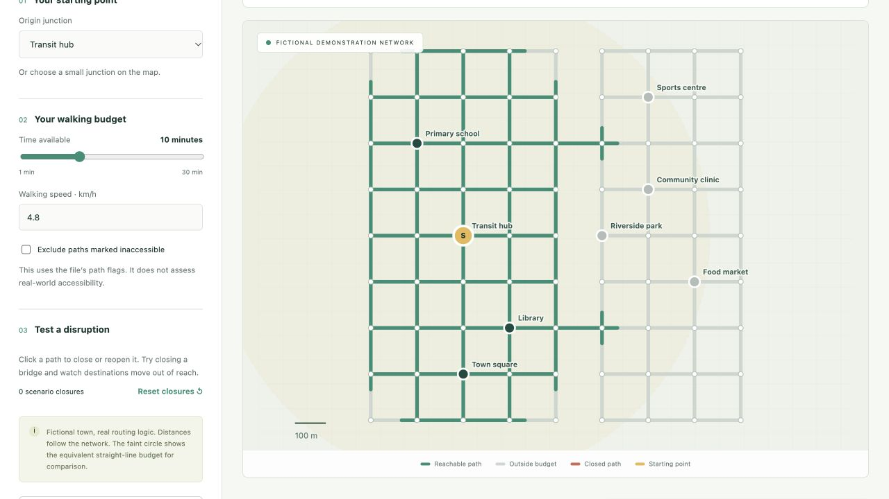

# WalkingIndex

**Explore what people can reach on foot—and how one broken connection changes access.**

[Open the interactive demo](https://alisammarraie.github.io/walkingindex/) · [Example GeoJSON](examples/canalside.geojson) · [Method](#method-and-limits)



WalkingIndex is a browser-based GIS prototype for testing walking catchments on a connected path network. Its fictional Canalside example has two bridges: close one, change walking speed or exclude flagged paths to see the effect on access to schools, transport and everyday services.

## Try it

1. Select an origin, or click a small map junction.
2. Set a time budget and walking speed.
3. Click a path to close it; click again to reopen it.
4. Compare reachable destinations and export the results as CSV.
5. Import your own GeoJSON to explore another network.

All file processing takes place in your browser. There is no backend, account or analytics integration.

## Import format

Use a WGS84 GeoJSON `FeatureCollection` with `[longitude, latitude]` coordinates:

| Geometry | Purpose | Optional properties |
|---|---|---|
| `LineString`, `MultiLineString` | Bidirectional walking paths | `name`, `accessible: false`, `closed: true` |
| `Point` | Destinations | `name`, `category` |

Paths connect at shared coordinate vertices (rounded to six decimal places). **Split paths at every intended junction.** Lines crossing without a shared vertex remain disconnected. Points attach to the nearest path vertex within 100 m; the straight connector distance is included in the walking distance. Distant points are marked unconnected.

Limits: 5 MB per file, 5,000 features, 10,000 unique vertices, 20,000 segments; city-scale extent below 2° longitude and latitude. Explicitly use WGS84; projected coordinates are unsupported.

## Method and limits

The routing engine uses Dijkstra’s algorithm with a binary min-heap. Edge weights are locally approximated metric lengths. Walking budget is `minutes × speed_kmh × 1000 / 60`. The catchment includes partial edge lengths and avoids double-counting overlapping reachable portions. The pale circle is a straight-line comparison only.

This is an educational prototype, not an official walkability score. It does not infer real accessibility, slope, crossing delays, safety, pavement condition or legal access. Accessibility mode only respects explicit path flags; destination connectors are unverified. Imported network quality determines the validity of results. All paths are treated as bidirectional. No OSM download or road snapping is performed.

## Run locally

```sh
python3 -m http.server 8000
# Open http://localhost:8000
```

Run the routing tests with Node.js 22 or later:

```sh
npm test
```

No package installation or build step is required.

## Implementation

`src/network.mjs` contains the independently testable graph and routing engine. `src/demo.mjs` generates fictional data. `src/app.mjs` renders an accessible SVG map and handles scenario controls and exports.

Tests cover detours, partial catchments, closures, disconnected components, path flags, point connectors, topology and invalid inputs.

Created by [alisammarraie](https://github.com/alisammarraie) with AI-assisted implementation and testing. Published as a transparent working prototype, with assumptions documented above. Licensed under MIT.
